# Buy Me a Flower — Tặng một bông hoa cho người bạn quý

**Buy Me a Flower** là bản demo một nền tảng để khán giả ủng hộ nhà sáng tạo Việt, làm hoàn toàn bằng tiếng Việt và tính bằng tiền đồng. Người hâm mộ "tặng một bông hoa" để nói lời cảm ơn; nhà sáng tạo có một trang cá nhân để:

- **Nhận ủng hộ một lần**: chọn số hoa, nhắn đôi lời, thanh toán bằng mã QR, ví điện tử hoặc thẻ
- **Mở hội viên hằng tháng** với nhiều hạng, quyền lợi và nội dung riêng
- **Bán sản phẩm số**: tệp tải về, lịch hẹn 1:1, vé sự kiện, nhận vẽ theo yêu cầu
- **Đăng bài viết, album ảnh, bài âm thanh** cho mọi người, người ủng hộ hoặc chỉ hội viên
- **Nhắn tin** cho từng người hoặc cả nhóm, gắn nút tặng hoa lên trang web, rút tiền về ngân hàng

> ⚠️ Đây là **sản phẩm demo giao diện** do [Ntahien Tech](https://ntahientech.com) thiết kế và lập trình. Các nhà sáng tạo, người ủng hộ, ngân hàng, ví điện tử và cổng thanh toán trong bản demo đều **hư cấu**; toàn bộ dữ liệu là **mô phỏng** và không có khoản tiền thật nào được chuyển. Ảnh minh hoạ thuộc giấy phép CC0 (xem [docs/IMAGE_CREDITS.md](docs/IMAGE_CREDITS.md)); người trong ảnh là người mẫu ảnh stock, không liên quan đến nhân vật trong bản demo.

🔗 **Demo:** https://buymeaflower.vercel.app — bấm **"Vào bằng tài khoản demo"** ở trang đăng nhập (hoặc mở thẳng [/quan-ly?demo=1](https://buymeaflower.vercel.app/quan-ly?demo=1)).

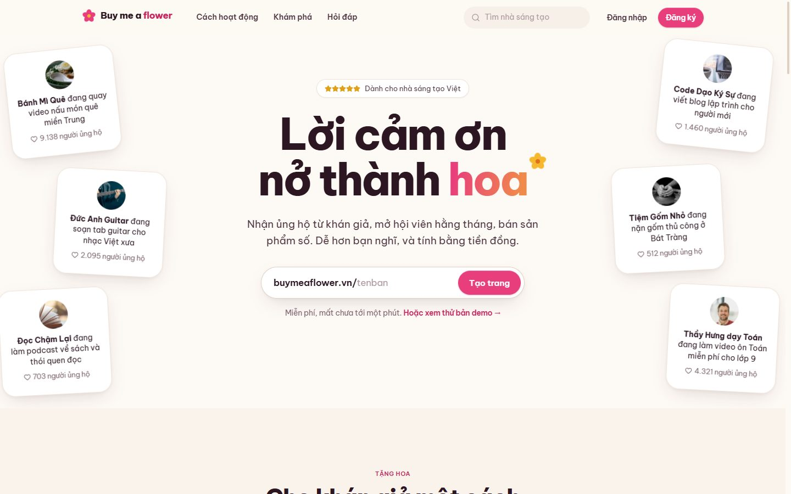

## Thử nhanh

- Ở trang **Đăng nhập**, bấm **"Vào bằng tài khoản demo"** để vào tài khoản của hoạ sĩ Mai Chi, hoặc mở thẳng `/quan-ly?demo=1`.
- Mở trang `/maichi` rồi **tặng thử một bông hoa**: chọn số hoa, viết lời nhắn, đi qua cổng thanh toán mô phỏng. Lượt ủng hộ hiện ngay trên trang và cộng vào thu nhập trong bảng quản lý.
- Mở trang của một nhà sáng tạo khác, ví dụ `/banhmique`, rồi **tham gia hội viên**: các bài viết đang khoá sẽ mở ra.
- **Đăng ký** một trang mới ở `/dang-ky` để xem luồng tạo trang từ đầu và các trạng thái trống.

Mọi thao tác được lưu trong trình duyệt (`localStorage`). Menu tài khoản có mục **Đặt lại dữ liệu demo**.

## Ảnh giao diện

| Trang cá nhân của nhà sáng tạo | Bảng quản lý |
|---|---|
| 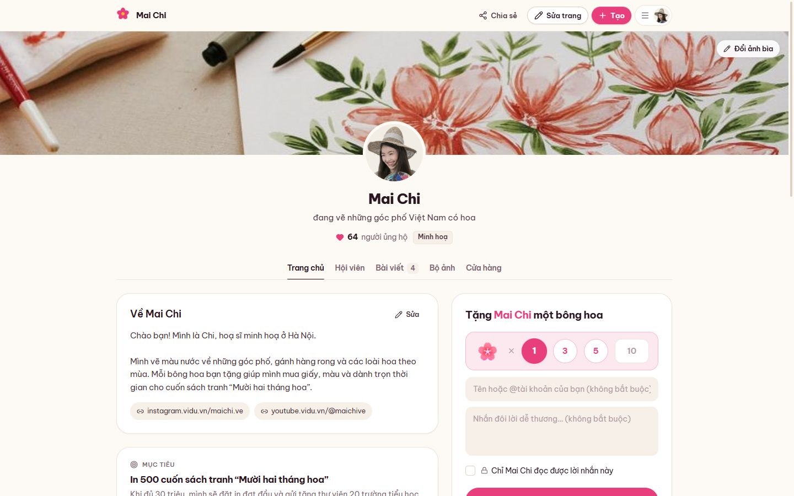 | 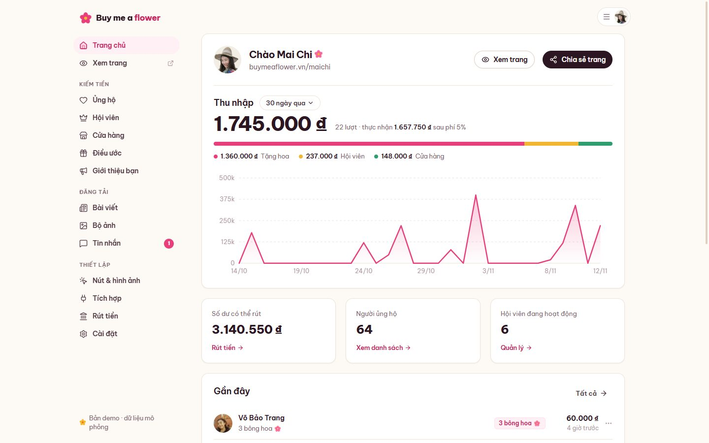 |
| **Cổng thanh toán mô phỏng** | **Các hạng hội viên** |
| 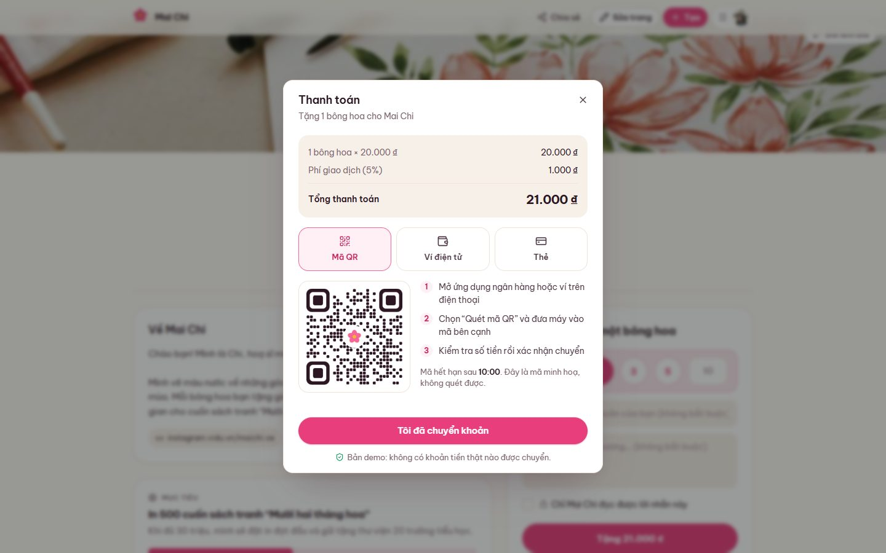 | 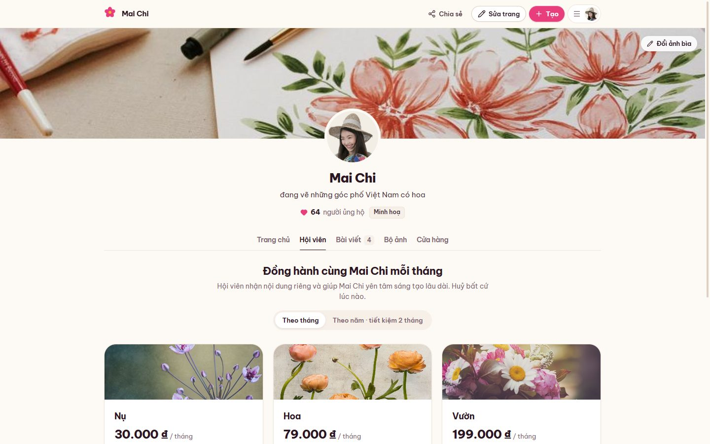 |
| **Cửa hàng** | **Trình soạn bài viết** |
| 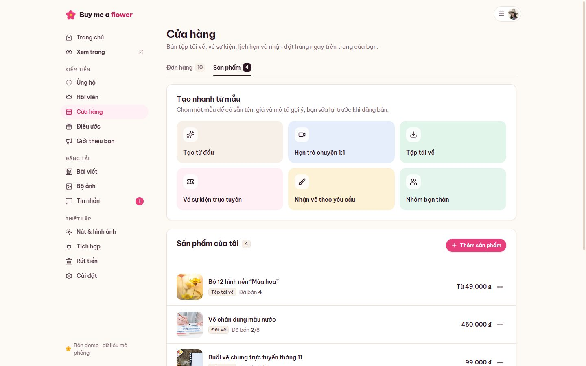 | 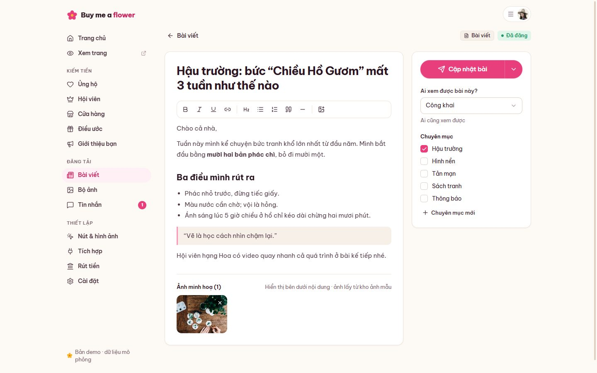 |
| **Tin nhắn** | **Rút tiền** |
| 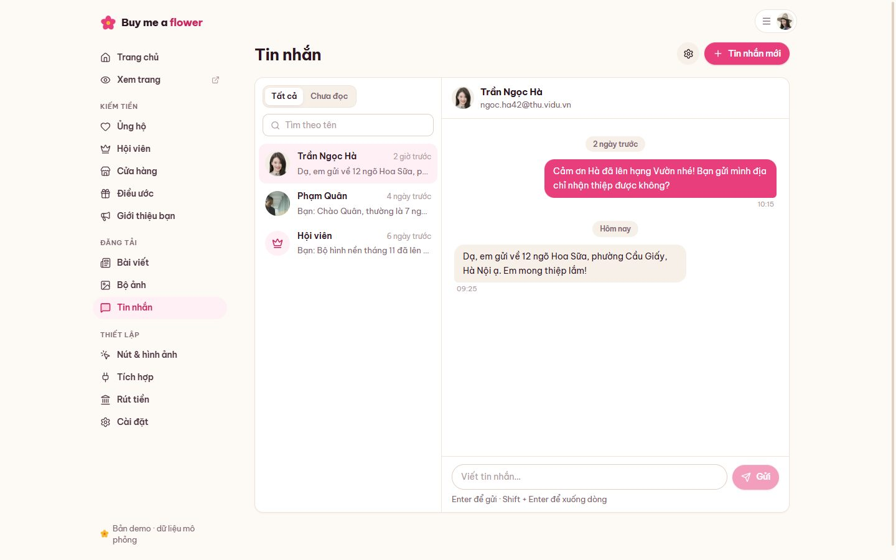 | 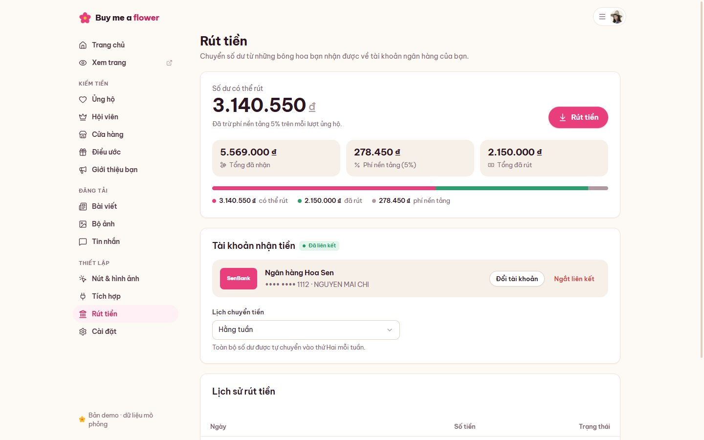 |
| **Khám phá nhà sáng tạo** | **Đăng ký** |
| 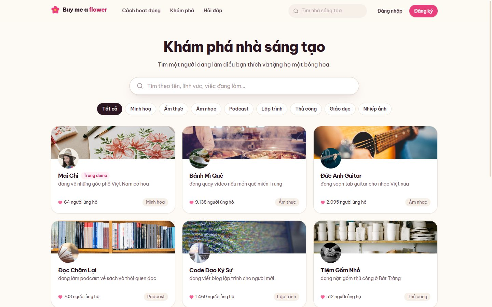 | 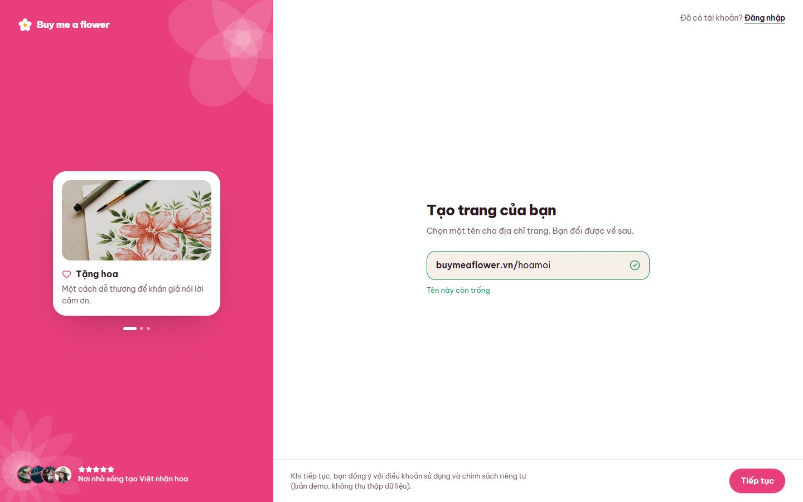 |
| **Giao diện tối** | **Điện thoại** |
| 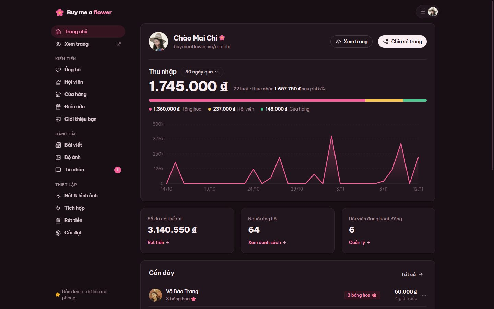 | 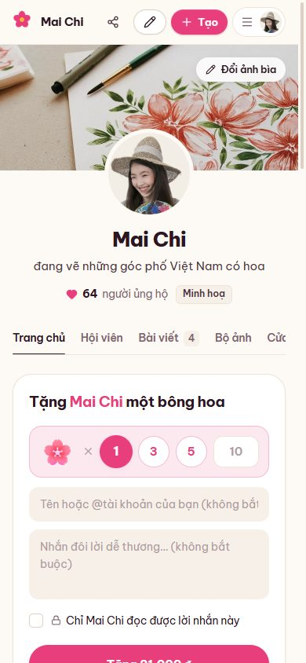 |

## Chạy thử

```bash
npm install
npm run dev        # http://localhost:5197
```

Bản build tĩnh: `npm run build`, kết quả nằm trong `dist`. Khi triển khai lên Vercel không cần chỉnh gì, vì tệp `vercel.json` đã cấu hình điều hướng cho ứng dụng một trang và cho phép nhúng vào ntahientech.com.

## Màn hình chính

| Khu vực | Nội dung |
|---|---|
| **Trang giới thiệu** | Thẻ nhà sáng tạo trôi nổi, ô chọn tên trang, ô tặng hoa chạy thật ngay trên trang, hội viên, cửa hàng, hỏi đáp |
| **Đăng ký / Hoàn thiện trang / Đăng nhập** | Kiểm tra tên trang còn trống, mật khẩu có thanh độ mạnh, mã xác minh, hồ sơ, liên kết ngân hàng, đăng nhập demo một chạm |
| **Trang cá nhân** | Ảnh bìa, màu chủ đề riêng, ô tặng hoa, mục tiêu gây quỹ, người ủng hộ gần đây kèm lời nhắn và lời cảm ơn; tab Hội viên, Bài viết, Bộ ảnh, Cửa hàng; chủ trang sửa trực tiếp (đổi "bông hoa" thành món khác, đổi màu, ảnh bìa) |
| **Bài viết** | Bài chữ, album ảnh, bài âm thanh; thích, bình luận; bài riêng khoá cho tới khi ủng hộ hoặc tham gia hội viên |
| **Bảng quản lý** | Thu nhập theo kỳ, cơ cấu theo nguồn, biểu đồ theo ngày, số dư, giao dịch gần đây |
| **Ủng hộ / Hội viên / Cửa hàng / Điều ước** | Danh sách, tìm kiếm, xuất CSV, hoàn tiền; trình soạn hạng hội viên và sản phẩm có xem trước trực tiếp; tạm dừng thu phí, tặng tư cách hội viên |
| **Bài viết / Bộ ảnh / Tin nhắn** | Trình soạn văn bản có định dạng, hẹn giờ đăng, chuyên mục; hộp thư 1-1 và gửi cho nhóm |
| **Nút & hình ảnh / Tích hợp** | Trình tạo nút và tiện ích nổi cho trang web, thông báo khi phát trực tiếp, mã QR, thiệp cảm ơn, webhook |
| **Rút tiền / Cài đặt / Tài khoản** | Luồng liên kết ngân hàng 5 bước, rút tiền, lịch sử; mục tiêu, thông báo, đổi tên trang, giao diện sáng / tối |

Xem thêm [docs/SCREEN_MAP.md](docs/SCREEN_MAP.md) và [docs/DESIGN_SYSTEM.md](docs/DESIGN_SYSTEM.md).

## Công nghệ

- React 19, Vite 6, Tailwind CSS v4 (token màu bằng biến CSS, có giao diện tối)
- React Router 7 (tải trang theo nhu cầu), Zustand 5 (lưu thao tác vào `localStorage`)
- Biểu đồ và mã QR minh hoạ vẽ bằng SVG, không dùng thư viện biểu đồ
- Font Be Vietnam Pro

## Cấu trúc thư mục

```
src
├── components/
│   ├── ui/          # Button, Input, Modal, Drawer, Popover, Tabs, Badge…
│   ├── brand/       # Logo, Flower, FlowerArt (khung ảnh), PetalRain
│   ├── layout/      # DashLayout, DashPage, UserMenu
│   └── charts.jsx   # AreaChart, MiniBars, SplitBar
├── features/        # support (ô tặng hoa, thanh toán), creator, public, kiemtien, dangtai, thietlap
├── pages/
│   ├── public/      # Giới thiệu, khám phá, đăng ký, đăng nhập…
│   ├── creator/     # Trang cá nhân, bài viết
│   └── dash/        # Các trang trong khu quản lý
├── data/            # Dữ liệu mẫu có hạt giống, nhà sáng tạo, hằng số, ánh xạ ảnh
├── store/           # Zustand: giao diện, đăng nhập, dữ liệu nhà sáng tạo
└── lib/             # Định dạng vi-VN, bộ sinh số ngẫu nhiên có hạt giống
public/images        # Ảnh CC0 đã cắt và nén
```

---

Thiết kế & phát triển bởi **Ntahien Tech** · [ntahientech.com](https://ntahientech.com)
